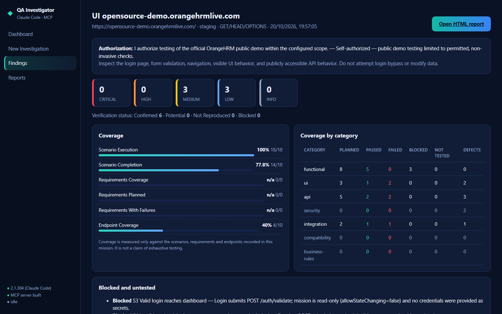
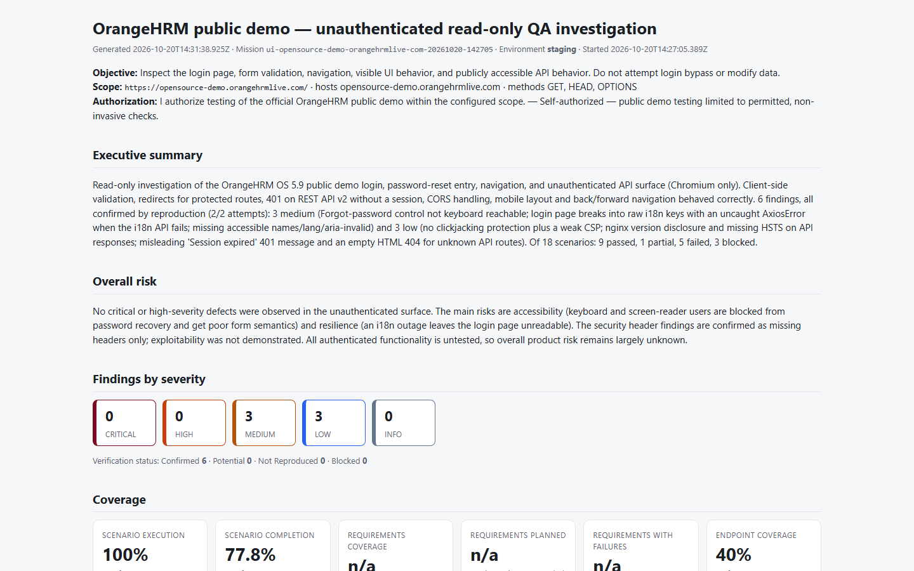
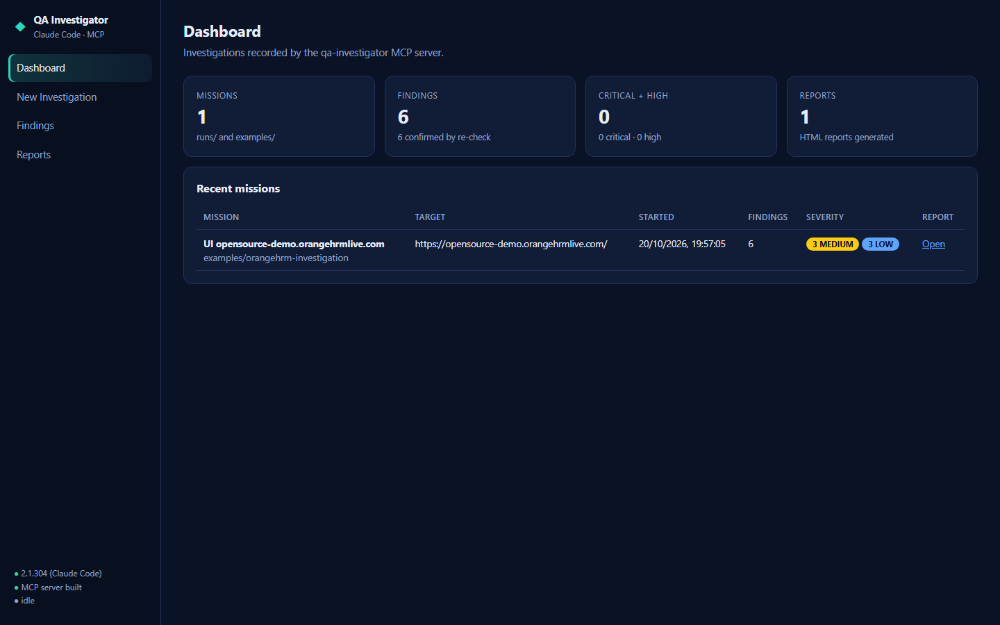
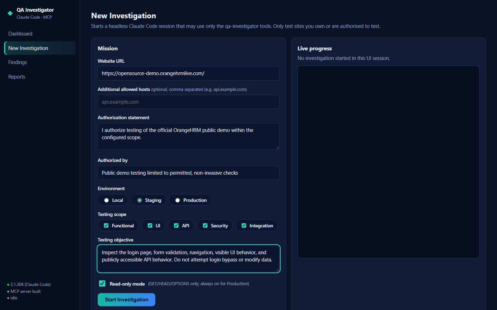

# QA Investigator AI

**An AI exploratory QA agent that investigates a web application the way a senior manual tester would. It plans by risk, collects evidence, confirms each defect by reproducing it, and writes an auditable report.**

    



## What it is

QA Investigator AI pairs **Claude Code** (the reasoning) with a custom **Model Context Protocol (MCP) server** (the hands). Claude decides what the application is for, ranks risks, picks test techniques and judges expected against actual behaviour. The MCP server gives it a real browser, a controlled HTTP client, an evidence store, defect tracking with verification, coverage metrics and report generation.

It works on any website you are authorised to test. Nothing is hard-coded for one target, and it **does not generate brittle test scripts**: every browser or API action is a generic, one-off step.

## Case study: OrangeHRM public demo

A read-only investigation of the public [OrangeHRM demo](https://opensource-demo.orangehrmlive.com/) covered the login page, the password-reset entry, navigation and the unauthenticated REST API.

| Result | Value |
|---|---|
| Findings | **6**, all **Confirmed** by automated reproduction (2/2 attempts) |
| Severity | 3 medium, 3 low, 0 high, 0 critical |
| Scenarios | 18 planned, 18 executed: 9 passed, 1 partial, 5 failed, 3 blocked (with reasons) |
| Endpoint coverage | 4 / 10 discovered endpoints |
| Mode | Read-only (GET/HEAD/OPTIONS), Chromium |

| ID | Severity | Finding |
|---|---|---|
| QA-001 | Medium | "Forgot your password?" control is not reachable with the keyboard |
| QA-002 | Medium | Login page shows raw translation keys and throws an uncaught AxiosError when the i18n API fails |
| QA-006 | Medium | Login and reset forms lack accessible names and page `lang`; validation errors are not exposed to assistive technology |
| QA-003 | Low | No clickjacking protection (no X-Frame-Options or CSP `frame-ancestors`); CSP allows `unsafe-inline` / `unsafe-eval` |
| QA-004 | Low | Server header discloses the nginx version; HSTS is missing on REST API and error responses |
| QA-005 | Low | REST API says "Session expired" to clients that never logged in; unknown API routes return an empty HTML 404 |

Full output: [summary](examples/orangehrm-investigation/summary.md) · [coverage matrix](examples/orangehrm-investigation/coverage-matrix.md) · [findings JSON](examples/orangehrm-investigation/findings.json) · [HTML report](examples/orangehrm-investigation/report.html) (download it and open it in a browser) · [evidence](examples/orangehrm-investigation/evidence)



## Screenshots

**Dashboard.** Every investigation with severity counts and a link to its report.



**New investigation.** Target, authorization, environment, scope and objective. Read-only mode is on by default and forced on for Production.



## Key features

- **Evidence-gated findings.** A finding cannot be recorded without evidence the tools captured themselves: screenshots, DOM, console, network and API exchanges, each with a SHA-256 hash. Findings start as *Potential*. Only reproduction makes them *Confirmed*.
- **Verification by reproduction.** Each defect is re-checked against a defect signature over fresh attempts. The result is Confirmed, Potential (intermittent), Not Reproduced or Blocked.
- **Honest coverage.** Every metric shows its numerator and denominator. Blocked and untested work is listed with reasons. The tool never claims complete coverage.
- **Risk-based planning.** Areas are scored by impact × likelihood × exposure. Scenarios use positive, negative, boundary, exception, recovery, integration, security and accessibility techniques.
- **Resilience testing.** It simulates dependency failures inside its own browser (abort, error status, delay). This is how QA-002 was found.
- **Duplicate detection.** Likely duplicate findings are rejected and similar ones are flagged.
- **Reports.** HTML, JSON and Markdown summaries plus a coverage matrix for every run.
- **One-command UI.** `npm start` builds everything and opens a local dashboard to start investigations and watch them live.

## Safety by design (enforced in code, not prompts)

- **Authorization required.** No mission starts without an authorization statement and a named authoriser.
- **Scope.** Requests and navigation outside the allowed hosts are refused, and bare wildcards are rejected. Off-scope navigations are blocked and logged.
- **Read-only by default.** POST, PUT, PATCH and DELETE need explicit permission. Production is always read-only in the UI.
- **Budgets.** Request and browser-action budgets, minimum spacing between requests, timeouts and response-size caps.
- **No attack tooling.** No brute force, credential testing, load generation or payload libraries. Input checks use inert markers.
- **Secrets.** Credentials are referenced by name and resolved on the server. Tokens, cookies and passwords are redacted from tool output, evidence and reports.

## Architecture

```
Browser UI (localhost:4300)
   │  starts a headless session per investigation
   ▼
Claude Code  (reasoning: risk, techniques, judgement)
   │  MCP over stdio
   ▼
qa-investigator MCP server (TypeScript)
   ├─ start_mission ─────── scope, authorization, limits, auth profiles
   ├─ inspect_page ──────┐
   ├─ interact_with_page ├─ Playwright: sessions, console/network capture,
   ├─ capture_evidence ──┘  scope guard, simulated dependency failures
   ├─ investigate_api ───── controlled HTTP: budgets, auth modes, schema
   │                        checks, passive security analysis
   ├─ record_finding ────── evidence-gated findings + duplicate detection
   ├─ verify_finding ────── reproduce → Confirmed / Potential / Not Reproduced / Blocked
   ├─ manage_coverage ───── requirements, risk-scored areas, scenarios, endpoints
   └─ generate_qa_report ── report.html, findings.json, summary.md, coverage-matrix.md
```

| Tool | Purpose |
|---|---|
| `start_mission` | Sets target URLs, allowed hosts, environment, authorization, allowed methods, limits and auth profiles. Every other tool refuses to run without it. |
| `inspect_page` | Page structure, forms and constraints, accessibility heuristics, layout problems, console errors, and the API calls the page made. |
| `interact_with_page` | Generic actions: navigate, click, fill (with secret references), select, press, wait, viewport, history, network simulation, session reset. |
| `capture_evidence` | Screenshot, DOM, console, network, storage (masked) and cookies (attributes only), with automated observations. |
| `investigate_api` | Up to 15 controlled requests per call, with auth modes, CORS origins, malformed bodies, idempotency repeats, and expectations on status, schema, headers and body. |
| `record_finding` | Full defect record: severity and priority with rationale, steps, expected result with its source, actual result, evidence, impact. |
| `verify_finding` | Reproduces a finding against its defect signature over N attempts. |
| `manage_coverage` | Requirements, risk-scored areas, scenarios, results and endpoints, plus metrics, gaps and next steps. |
| `generate_qa_report` | Writes the HTML, JSON and Markdown reports and the coverage matrix. |

## Getting started

Prerequisites: Node.js 20+, and [Claude Code](https://claude.com/claude-code) installed and signed in (`claude` on PATH). No API key is needed; it uses your Claude Code session.

```powershell
git clone https://github.com/lavanya776/QA-Investigator-AI.git
cd QA-Investigator-AI
npm install
npx playwright install chromium
npm start                 # builds, then opens the UI at http://127.0.0.1:4300
```

Then open **New Investigation** and enter, for example:

- **Website URL:** `https://opensource-demo.orangehrmlive.com/`
- **Environment:** Staging, with **Read-only** on
- **Authorization statement** and **Authorized by:** who allowed the testing
- **Objective:** for example, "Inspect the login page, form validation, navigation and public API behaviour. Do not attempt login bypass or modify data."

Press **Ctrl+C** to stop the UI. Any running investigation, its MCP server and its browser stop with it.

### Self-test

```powershell
npm run smoke             # 25 checks of the MCP server against a local fixture; no external site is contacted
```

### Use it from an interactive Claude Code session

The server is defined in `.mcp.json`. Run `npm run build`, then start `claude` in this folder and approve the `qa-investigator` server (or use `/mcp`). Then ask, for example: *"Investigate https://opensource-demo.orangehrmlive.com with the qa-investigator tools. I authorise read-only functional, API and non-destructive security checks."*

### Test accounts (optional)

Copy `.qa-secrets.example.json` to `.qa-secrets.json` (gitignored), or set the same names as environment variables. Missions refer to secrets by name only, and their values never appear in output, evidence or reports.

## Project structure

```
src/                  MCP server (TypeScript)
  server.ts           entry point: stdio (default) or --http <port>
  tools/register.ts   the 9 tools: zod input/output schemas
  core/               mission scope, safety, state store, redaction, secrets
  browser/            Playwright engine, page inspection, actions
  api/                controlled HTTP client, passive analysis, JSON Schema checks
  findings/           record, deduplicate, verify
  coverage/           requirements, areas, scenarios, endpoints, metrics
  report/             HTML / JSON / Markdown
ui/                   local web UI (server.mjs + public/)
scripts/              smoke-test.mjs (self-test), mcp-call.mjs (generic MCP client)
examples/             orangehrm-investigation: the case study above
docs/images/          screenshots
```

## Limitations

- Accessibility checks are heuristics, not a full WCAG audit.
- Passive security analysis is indicator-based. Indicators are never filed as findings automatically.
- Pages behind a login are recorded as blocked unless test accounts are configured. In the OrangeHRM case study all authenticated features were out of scope.
- Only Chromium was installed for the case study. Firefox and WebKit work if installed.

## Roadmap

1. Parallel API sends to test races and idempotency.
2. axe-core integration for broader accessibility rules.
3. HAR import to discover endpoints from recorded traffic.
4. Visual diff between screenshots for re-investigation.
5. Comparison across runs (fixed, new or still failing) to support re-test cycles.
